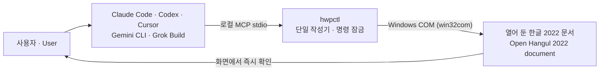

# hwpctl

[](https://github.com/Jasujung99/hwpctl/actions/workflows/ci.yml)
[](https://github.com/Jasujung99/hwpctl/releases)
[](LICENSE)


**열린 한/글 2022 문서를 AI 코딩 도구가 직접 편집하게 하는 로컬 MCP·CLI 브리지**<br>
*A local MCP/CLI bridge that lets AI coding agents edit an open Hancom Office Hangul 2022 document.*

[한국어](#한국어) · [English](#english)



---

## 한국어

### hwpctl은

Claude Code, Codex, Cursor, Gemini CLI, Grok Build 같은 AI 도구가 **사용자가 열어 둔 한글 2022 창**을
Windows COM으로 직접 고치게 합니다. 바뀐 내용은 한/글 화면에서 바로 확인합니다. 클라이언트마다
한/글 로직을 따로 두지 않고, 설정만 바꿔 같은 `hwpctl` 서버에 붙습니다.

| 하는 것 | 하지 않는 것 |
|---|---|
| 문단·글자 서식, 표(생성·채우기·병합·격자·여백), 글상자·도형·그림, **글맵시(글자 그러데이션)**, 쪽 설정·쪽 번호 | 키 입력 흉내(SendKeys), 자동 저장 |
| 명령마다 Undo 단위 기록과 `undo` | 명시 플래그 없는 원본 덮어쓰기·문서 닫기 |
| 쪽 렌더(`render_page`)와 측정 비교(`compare_render`) | 한글 2024 전용 API 사용, 범용 HWP 변환기 역할 |
| 한/글 없이 `.hwpx` 읽기(`hwpx_inspect`) | 글맵시의 회전·뒤집기·자체 그림자 재현 |
| 참조 문서를 명세로 바꿔 새 문서로 재구성(실험: `reference_to_spec`·`build_document`) | 네이티브 차트(`insert_chart`)는 검증 빌드에서 사용 비권장 ([#33](https://github.com/Jasujung99/hwpctl/issues/33)) |

새 문서에서 미리보기 후 적용하는 좁고 안전한 방식이 필요하면 [HWP Live Safe](https://github.com/Jasujung99/hwp-live-safe)를,
클라이언트·엔진 조합 안내는 [HWP AI Bridge](https://github.com/Jasujung99/hwp-ai-bridge)를 보세요.

### 빠른 시작

요구 사항: Windows, 한글 2022(검증 빌드 `12.0.0.850`), Python 3.10 이상.

**1. 전용 가상환경에 설치합니다.** MCP 서버 실행 파일이 소스 폴더에 묶이지 않도록 `-e` 설치는 피합니다.

```bat
py -3.13 -m venv C:\hwpctl\venv
C:\hwpctl\venv\Scripts\python -m pip install "hwpctl[windows] @ https://github.com/Jasujung99/hwpctl/releases/download/v0.2.1/hwpctl-0.2.1-py3-none-any.whl"
```

**2. AI 클라이언트에 등록합니다.** Claude Code 예:

```bat
claude mcp add hwpctl -- C:\hwpctl\venv\Scripts\hwpctl.exe mcp
```

Codex·Cursor·Gemini CLI·Grok Build 설정은 [클라이언트 연결](docs/guide/clients.md)에 있습니다.

**3. 한글 2022에서 문서를 하나 열고 확인합니다.**

```bat
C:\hwpctl\venv\Scripts\hwpctl doctor
C:\hwpctl\venv\Scripts\hwpctl status
```

이제 AI에게 "이 문서에 4열 8행 표를 넣고 첫 행을 회색으로 해 줘"처럼 요청하면 됩니다.
업데이트할 때는 MCP 클라이언트를 모두 종료한 뒤 다시 설치합니다([설치](docs/guide/install.md#업데이트)).

### 대표 도구

<!-- hwpctl-tool-highlights:start -->
| 도구 | 하는 일 |
|---|---|
| `open` | 활성 창 고정, 파일 열기, `--new`로 새 문서 |
| `snapshot` | 제목·본문·표·선택 영역 읽기 |
| `insert_paragraph` | 서식 있는 문단·글자 런 삽입 |
| `create_table` | 표 생성, 첫 행 배경색, 기본 칸 안여백 |
| `fill_cells` | 표 셀 값 채우기 |
| `layout_review` | 표 편집 뒤 줄바꿈·행 높이·본문 폭 검토와 수정 |
| `insert_shape` | 편집 가능한 사각형·타원·선 삽입 |
| `insert_text_art` | 글맵시: 글자에 그러데이션 채우기, 모양 55종 |
| `insert_text_box` | 편집 가능한 글상자 (채우기·테두리·그림자·위치) |
| `render_page` | 쪽을 이미지로 렌더해 결과 확인 |
| `undo` | 직전 hwpctl 명령을 Undo 한 덩어리로 되돌리기 |
| `save_as` | 새 경로에 저장 (원본 경로는 거부) |
<!-- hwpctl-tool-highlights:end -->

전체 55개 도구: [도구 레퍼런스](docs/guide/tools.md)

### 안전 원칙

- **자동 저장하지 않습니다.** `save_as`는 새 경로만 받고, 원본 덮어쓰기는 `save --overwrite`가 필요합니다.
- 문서 닫기는 `--force`, 수정본을 버리고 다른 파일 열기는 `--discard`를 명시해야 합니다.
- 명령 단위 잠금으로 한 번에 하나의 작성기만 문서를 고칩니다.
- 한/글 대화상자가 떠 있으면 대신 누르지 않고 한국어 오류로 멈춥니다.
- hwpctl 명령 사이에 직접 편집했다면 `undo` 대신 한/글의 Ctrl+Z를 쓰세요.

자세히: [안전 장치](docs/guide/safety.md) · [알려진 한계](KNOWN_LIMITATIONS.md)

### 문서

- 사용 가이드: [설치](docs/guide/install.md) · [클라이언트 연결](docs/guide/clients.md) ·
  [도구 레퍼런스](docs/guide/tools.md) · [표와 서식](docs/guide/tables-and-formatting.md) ·
  [차트](docs/guide/charts.md) · [글맵시](docs/guide/text-art.md) · [HWPX 작성(실험)](docs/guide/hwpx-authoring.md) ·
  [안전 장치](docs/guide/safety.md)
- [알려진 한계](KNOWN_LIMITATIONS.md) · [변경 기록](CHANGELOG.md) · [보안 정책](SECURITY.md) ·
  [기여 안내](CONTRIBUTING.md) · [제3자 고지](THIRD_PARTY_NOTICES.md) · [전체 문서 목록](docs/README.md)

### 범위와 라이선스

`hwpctl`은 독립적인 오픈 소스 프로젝트이며 한글과컴퓨터가 제공·보증·후원하는 공식 제품이
아닙니다. 사용자는 유효한 한글 라이선스와 해당 자동화 사용 조건을 직접 확인해야 합니다.
이 저장소의 코드는 [MIT 라이선스](LICENSE)로 배포되며, 한글 및 제3자 패키지는 각자의
라이선스를 따릅니다.

---

## English

### What is hwpctl?

hwpctl lets AI coding agents such as Claude Code, Codex, Cursor, Gemini CLI and Grok Build edit
**the Hancom Office Hangul 2022 document you already have open**, through Windows COM. Every change
appears live in the Hangul window. Clients carry no Hangul-specific logic; they all connect to the
same `hwpctl` server with a small configuration change.

| Does | Does not |
|---|---|
| Paragraph and character formatting, tables (create, fill, merge, grid, cell margins), text boxes, shapes, pictures, **TextArt (gradient-filled text)**, page setup and page numbers | Simulate keystrokes (SendKeys) or autosave |
| Record each command as one Undo unit, with `undo` | Overwrite the original or close documents without an explicit flag |
| Render pages (`render_page`) and measure differences (`compare_render`) | Use Hangul 2024-only APIs or act as a general HWP converter |
| Read `.hwpx` without Hangul (`hwpx_inspect`) | Reproduce TextArt rotation, flips or its own shadow |
| Rebuild a reference document from a spec (experimental: `reference_to_spec`, `build_document`) | Native charts (`insert_chart`) — not recommended on the verified build ([#33](https://github.com/Jasujung99/hwpctl/issues/33)) |

For a narrower, preview-first workflow on a new document, see [HWP Live Safe](https://github.com/Jasujung99/hwp-live-safe).
For choosing a client and engine combination, see [HWP AI Bridge](https://github.com/Jasujung99/hwp-ai-bridge).

### Quick start

Requirements: Windows, Hancom Office Hangul 2022 (verified build `12.0.0.850`), Python 3.10+.

**1. Install into a dedicated virtual environment.** Avoid editable (`-e`) installs for the MCP
runtime, so the server executable is not tied to a source checkout.

```bat
py -3.13 -m venv C:\hwpctl\venv
C:\hwpctl\venv\Scripts\python -m pip install "hwpctl[windows] @ https://github.com/Jasujung99/hwpctl/releases/download/v0.2.1/hwpctl-0.2.1-py3-none-any.whl"
```

**2. Register it with your client.** Claude Code example:

```bat
claude mcp add hwpctl -- C:\hwpctl\venv\Scripts\hwpctl.exe mcp
```

Configurations for Codex, Cursor, Gemini CLI and Grok Build are in [client setup](docs/guide/clients.md).

**3. Open a document in Hangul 2022 and check the connection.**

```bat
C:\hwpctl\venv\Scripts\hwpctl doctor
C:\hwpctl\venv\Scripts\hwpctl status
```

Then ask your agent, for example: "Insert a 4-column, 8-row table with a gray header row."
To update, quit every MCP client first, then reinstall ([install guide](docs/guide/install.md#업데이트)).

### Key tools

<!-- hwpctl-tool-highlights:start -->
| Tool | What it does |
|---|---|
| `open` | Pin the active window, open a file, or create a new document with `--new` |
| `snapshot` | Read the title, body, tables and current selection |
| `insert_paragraph` | Insert formatted paragraphs and text runs |
| `create_table` | Create a table with an optional header fill and default cell padding |
| `fill_cells` | Fill table cells |
| `layout_review` | Review and fix wrapping, row heights and body width after table edits |
| `insert_shape` | Insert an editable rectangle, ellipse or line |
| `insert_text_art` | TextArt: gradient-filled text in 55 native shapes |
| `insert_text_box` | Insert an editable text box (fill, border, shadow, position) |
| `render_page` | Render a page to an image to check the result |
| `undo` | Undo the previous hwpctl command as one unit |
| `save_as` | Save to a new path (the original path is refused) |
<!-- hwpctl-tool-highlights:end -->

All 55 tools: [tool reference](docs/guide/tools.md)

### Safety

- **No autosave.** `save_as` only writes to a new path; overwriting the original requires `save --overwrite`.
- Closing a document requires `--force`; discarding changes to open another file requires `--discard`.
- A per-command lock keeps a single writer on the document at a time.
- If a Hangul dialog is open, hwpctl stops with an error instead of clicking it for you.
- If you edited the document by hand between hwpctl commands, use Ctrl+Z in Hangul instead of `undo`.

Details: [safety](docs/guide/safety.md) · [known limitations](KNOWN_LIMITATIONS.md)

### Documentation

The detailed guides are currently written in Korean.

- Guides: [install](docs/guide/install.md) · [client setup](docs/guide/clients.md) ·
  [tool reference](docs/guide/tools.md) · [tables and formatting](docs/guide/tables-and-formatting.md) ·
  [charts](docs/guide/charts.md) · [TextArt](docs/guide/text-art.md) · [HWPX authoring (experimental)](docs/guide/hwpx-authoring.md) ·
  [safety](docs/guide/safety.md)
- [Known limitations](KNOWN_LIMITATIONS.md) · [Changelog](CHANGELOG.md) · [Security](SECURITY.md) ·
  [Contributing](CONTRIBUTING.md) · [Third-party notices](THIRD_PARTY_NOTICES.md) · [All docs](docs/README.md)

### Scope and license

`hwpctl` is an independent open-source project. It is not provided, endorsed or sponsored by
Hancom Inc. You are responsible for holding a valid Hangul license and following its automation
terms. The code in this repository is released under the [MIT License](LICENSE); Hangul and
third-party packages follow their own licenses.
